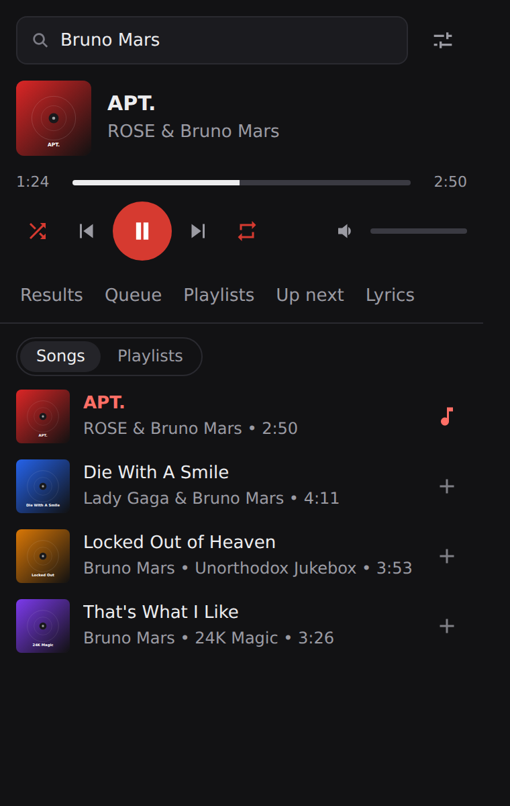
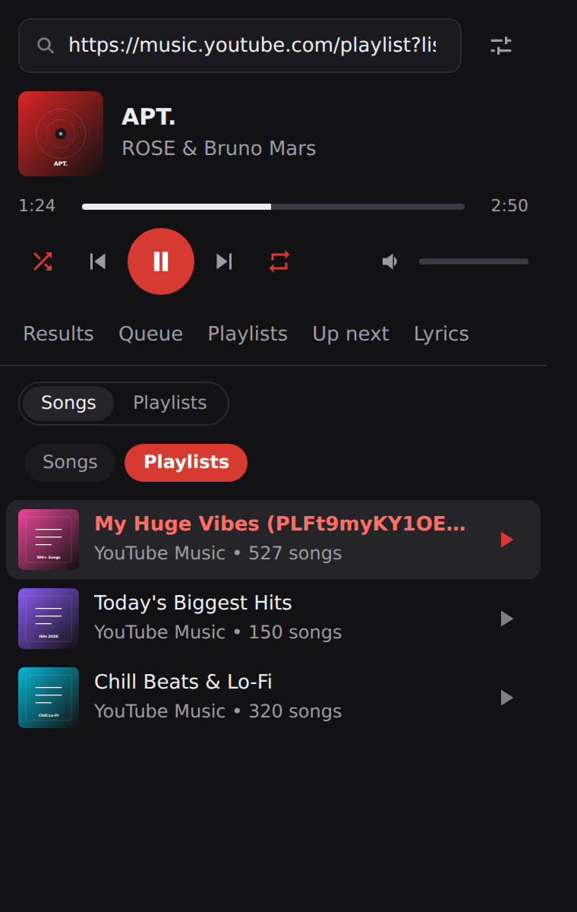
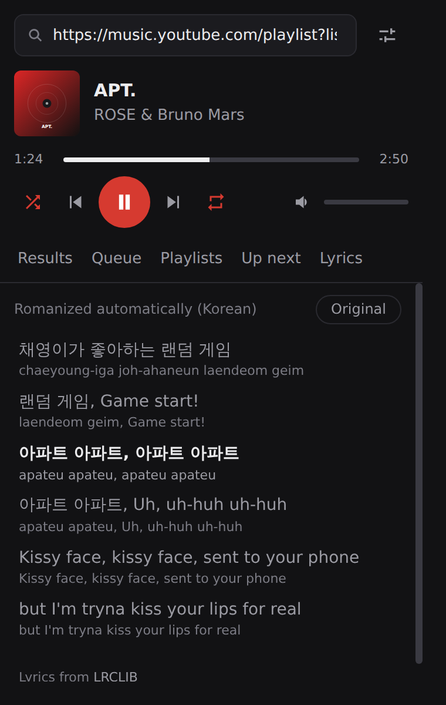
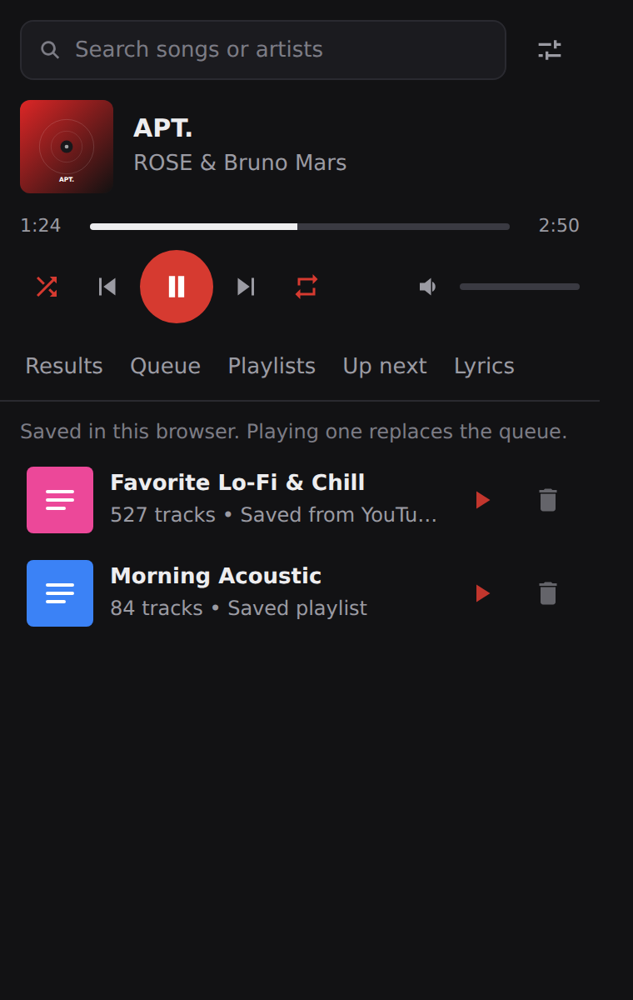

# 🎵 vibing son

[](https://developer.chrome.com/docs/extensions/mv3/intro/)
[](LICENSE)
[](https://music.youtube.com)
[](PRIVACY.md)

A distraction-free, toolbar-first YouTube Music companion for Chrome, Firefox, and Chromium-based browsers. 

Search, stream in the background, paste playlist URLs directly, manage your queue, and sing along with synced & offline-romanized lyrics — **without opening a YouTube Music tab, and without an API key**.

<p align="center">
  
  
  
  
</p>

---

## ✨ Features

- **🎧 True Background Playback:** Music plays from a lightweight, isolated offscreen player. Closing the popup never stops or interrupts playback, and no extra browser tab is ever kept open.
- **🔗 Instant Playlist URL Auto-Detection:** Paste any YouTube or YouTube Music playlist link (`music.youtube.com/playlist?list=...`, `youtube.com/watch?v=...&list=...`, `youtu.be/...`, or raw `PL...` ID) directly into the search bar. The extension resolves it immediately to stream or save.
- **🔍 Native YouTube Music Search & Autocomplete:** Searches official studio tracks, artists, and albums (filtering out noisy video uploads). Supports real-time query suggestions with keyboard shortcuts (`↓` / `↑` to navigate, `→` to append, `Enter` to search, `Esc` to dismiss).
- **🎤 Synced & Romanized Lyrics:** Line-by-line synchronized lyrics powered by [LRCLIB](https://lrclib.net). Includes built-in **offline romanization** for Korean (Hangul) and Japanese (Kanji/Kana) songs so you can sing along without looking up romanized lyrics manually.
- **📜 Smart Queue & Endless Radio:** Full queue management (Play Next, Add to Queue, Reorder, Remove). When your queue ends, **vibing son** automatically spins up YouTube Music's radio stream based on your last track to keep the music flowing.
- **🔀 Looping & Shuffle Controls:** Seamless Repeat All, Repeat One, and random Shuffle modes right on the transport bar.
- **📚 Deep Playlist Pagination (500+ Songs):** Automatically fetches full YouTube Music playlists using continuation tokens—supporting massive playlists up to 2,000 tracks without truncation.
- **💾 Local Saved Playlists:** Save your active queue or imported playlists locally in browser storage. No accounts, login, or cloud syncing required.
- **🎛️ Full Player Controls:** Scrubbing seek bar, volume control with cross-session persistence, mute toggle, repeat, and shuffle.
- **🔒 Private & Lightweight:** Zero telemetry, no external analytical scripts, and no user tracking. All data (queue, history, saved playlists) remains exclusively on your machine.

---

## 🚀 Installation

*vibing son is built directly from source and packaged for self-hosting or loading unpacked.*

### 🌐 Chrome, Brave, Edge, Opera (Chromium 116+)

1. Download [`vibing-son-0.0.1.zip`](https://github.com/Sonraku13/vibing-son/releases/latest) from the Releases section and unzip it (or clone this repository).
2. Navigate to `chrome://extensions` in your browser.
3. Enable **Developer mode** toggle in the top-right corner.
4. Click **Load unpacked** and choose the unzipped repository/release folder.
5. Pin **vibing son** to your toolbar for one-click access.

> *To update:* Replace the folder with the newest release and click the Reload button on the extension card in `chrome://extensions`.

### 🦊 Firefox (140+)

1. Download [`vibing-son-0.0.1-firefox.zip`](https://github.com/Sonraku13/vibing-son/releases/latest) (do not unzip).
2. Navigate to `about:debugging#/runtime/this-firefox`.
3. Click **Load Temporary Add-on…** and select the `.zip` package.
4. **First playback permission:** Firefox blocks media autoplay by default. When the extension opens, click the **Allow autoplay** banner and choose **Allow Audio and Video** in your address bar icon.

---

## 🛠️ Architecture & How It Works

Manifest V3 restricts long-running background tasks. **vibing son** leverages an asynchronous offscreen document to host a controlled YouTube iframe while maintaining a minimal memory footprint.

```
┌──────────────┐   Message Passing (chrome.runtime)   ┌───────────────────────────┐
│  Popup UI    ├─────────────────────────────────────▶│  Background Service       │
│  (HTML/CSS)  │◀─────────────────────────────────────┤  Worker                   │
└──────────────┘                                      └─────────────┬─────────────┘
                                                                    │ Load / Seek / Toggle
                                                                    ▼
                                                      ┌───────────────────────────┐
                                                      │  Offscreen Document       │
                                                      │  (Embedded YouTube IFrame)│
                                                      └───────────────────────────┘
```

| Component | Path | Responsibility |
|---|---|---|
| **Popup UI** | `popup/` | User interface: search bar, queue manager, tabs, settings, and lyric highlighter. |
| **Service Worker** | `background/service-worker.js` | Core orchestration: search querying, playlist resolution, queue storage, and state broadcast. |
| **Offscreen Player** | `offscreen/` | Hidden document hosting the playback iframe driven via postMessage API. |
| **Playlist Parser** | `popup/playlist-url.js` | Fast regex & URL normalization for YouTube & YouTube Music playlist links. |
| **Offline Romanizer** | `popup/romanize.js` | Algorithmic Hangul decomposition & compressed Japanese reading dictionary (~130 KB). |

---

## 💻 Development

The extension is written in pure vanilla JavaScript, HTML5, and CSS3 without requiring compilers or heavy bundling tools.

### Prerequisites
- Node.js 22.2+ (for linters and automated packaging)

### Commands

```bash
# Install development tooling (ESLint)
npm install

# Run static checks, ESLint, and unit test suites
npm test

# Build production zip archives for Chromium & Firefox
npm run package
```

The build script generates production packages under `dist/`:
- `dist/vibing-son-1.2.0.zip` (Chromium MV3)
- `dist/vibing-son-1.2.0-firefox.zip` (Firefox MV3)

---

## ⚠️ Notes & Limitations

- **Unofficial YouTube Music API:** Relies on YouTube Music's internal `WEB_REMIX` client protocol without API keys.
- **Playback Ads:** Playback is executed through YouTube's official player backend, so occasional advertisements may play based on YouTube policies.
- **Embedded Playback Restrictions:** Tracks marked by content owners as non-embeddable outside YouTube are automatically skipped to keep queue continuity.
- **Optional Fallback API Key:** If internal search endpoints are ever blocked by network restrictions, you can provide an optional YouTube Data API v3 key in the settings drawer.

---

## 📜 License & Acknowledgments

- Licensed under the [MIT License](LICENSE).
- Lyrics provided via [LRCLIB](https://lrclib.net).
- Japanese offline reading dictionary (`data/ja-readings.gz`) is derived from JMdict & KANJIDIC2 by the [Electronic Dictionary Research and Development Group](https://www.edrdg.org/) ([CC BY-SA 4.0](https://creativecommons.org/licenses/by-sa/4.0/)).
- Based on the foundational architecture by [muhamadsyahrulmubarok](https://github.com/muhamadsyahrulmubarok/pocketbeat).
